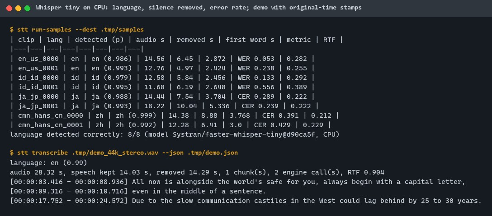
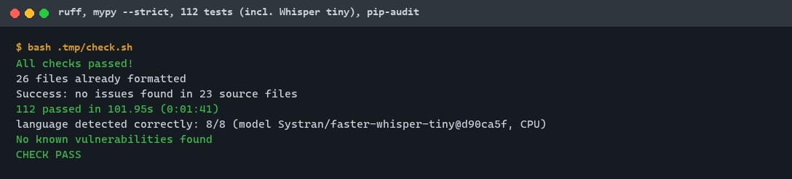
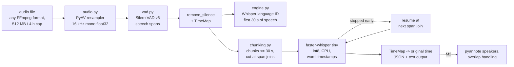
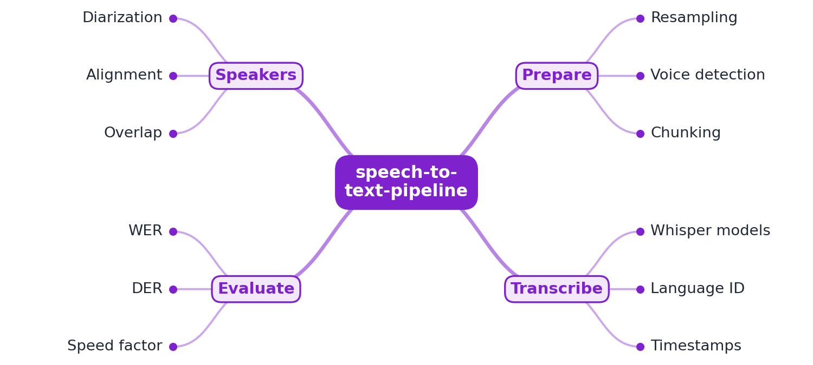

# speech-to-text-pipeline

[](https://github.com/EquinoxWN/speech-to-text-pipeline/actions/workflows/ci.yml)


> Meeting recordings nobody has time to rewatch: accurate transcripts with speaker labels and timestamps, with accuracy measured, not assumed. M1 turns any audio file into 16 kHz mono, cuts silence with Silero VAD, detects the language and transcribes with faster-whisper, with every word timestamp mapped back to the original recording.

Part of my **AI and Machine Learning** list · Python · core project

## Proof it works

On 8 public FLEURS clips (English, Indonesian, Japanese, Chinese), each padded with 2 s of silence,
Whisper tiny on CPU detects the right language for all 8 (probability 0.979 to 0.999), VAD removes
the added silence, and the first word lands after the 2 s pad in the original timeline. A 28 s,
44.1 kHz stereo file with two sentences and long pauses comes back with 14.3 s of silence removed
and both sentences at their original times:



112 tests pass, 14 of them against the real Whisper tiny model (language detection, a 5 s shift
test for word times, joined utterances), and the dependency audit is clean:



## Architecture

**What M1 runs today:**



**Full roadmap (M1 to M3):**



## How it works

_Steps 1 and 2 are built and tested; the rest is on the [roadmap](#roadmap)._

1. Audio is resampled, and voice-activity detection removes silence before transcription.
2. faster-whisper transcribes chunks with word timestamps and detects the language (including Indonesian, Japanese and Chinese).
3. pyannote diarization finds who spoke when, and words are aligned to speakers.
4. Overlapping speech and long recordings are handled with careful chunk boundaries.
5. Word error rate and diarization error rate are measured on public test sets per language.
6. Speed and accuracy are compared across model sizes on CPU and GPU.

Details of M1:

- **Resampling:** PyAV (bundled FFmpeg) decodes the first audio stream and resamples to 16 kHz mono
  float32 in one filtered pass; content above 8 kHz is removed, not folded. Size and length caps
  are checked while decoding.
- **Silence removal:** Silero VAD v6 (the ONNX model shipped in faster-whisper) finds speech spans
  (threshold 0.5, 500 ms minimum silence, 200 ms padding). Spans are concatenated, and a `TimeMap`
  maps any time in the silence-free audio back to the original recording.
- **Language:** Whisper's language token on the first 30 s of speech, or a forced `--language`.
- **Transcription:** spans are packed into chunks of at most 30 s, cut at silences; each chunk is
  transcribed with word timestamps. If Whisper stops before the end of a chunk (it can after VAD
  joins two utterances), the rest is sent again from the next span join
  ([ADR 0002](docs/adr/0002-own-vad-and-time-map-around-faster-whisper.md)).
- **Model:** Whisper tiny, int8 on CPU, pinned to a Hugging Face commit
  ([ADR 0003](docs/adr/0003-whisper-tiny-int8-on-cpu-with-pinned-revisions.md)).

## Who it helps

- **Who:** engineers building meeting, interview or call transcription, and teams checking a speech
  model on their own recordings before trusting it.
- **The problem:** recordings come in many formats and are mostly silence; after silence is cut,
  timestamps easily point to the wrong place, and the spoken language is not known in advance.
- **How to use it:** `stt transcribe meeting.m4a --json out.json` gives the language, how much
  silence was removed, and segments and words with times in the original file; `stt run-samples`
  shows on public clips whether language detection and timing hold before you use it on your own audio.

## Tech stack

| Area | In M1 | Planned |
|---|---|---|
| Core | Python 3.11+, faster-whisper 1.2 (CTranslate2), Whisper tiny int8 on CPU, PyAV, NumPy | pyannote.audio diarization, base to large-v3 models, GPU runs |
| Pipeline | FFmpeg resampling to 16 kHz mono, Silero VAD v6 (onnxruntime), time map, 30 s chunking with resume pass | overlap-aware chunk boundaries, word-to-speaker alignment |
| Eval | 8 FLEURS clips (SHA-256 pinned): language detection, seconds removed, WER/CER, real-time factor | WER and DER per language on full public test sets |

Language: **Python** (3.11+). Code in [`src/speech_to_text_pipeline/`](src/speech_to_text_pipeline): `audio.py` (decode, resample, WAV writer), `vad.py` (Silero VAD, `TimeMap`), `chunking.py`, `engine.py` (faster-whisper engine, pinned models), `pipeline.py`, `transcript.py` (JSON and text output), `metrics.py` (WER, CER), `samples.py` (verified clip downloads), `files.py` (atomic writes), `cli.py`.

## Run it

**Prerequisites:** Python 3.11+ (CI uses 3.12). CPU only; no FFmpeg install needed (PyAV bundles it).
About 80 MB of disk for the model and clips, and a few hundred MB of memory.

```bash
python -m venv .venv && source .venv/bin/activate   # Windows: .venv\Scripts\activate
export HF_HOME="$PWD/.tmp/hf"   # keep the model cache inside the repo (optional)
make setup      # install the package and dev tools
make lint       # ruff, ruff format, mypy --strict
make test       # fetch 8 clips (2.5 MB) and Whisper tiny (75 MB), then 112 tests
make run        # language, silence removed and error rate on the 8 clips
```

More runs:

```bash
stt transcribe meeting.m4a --json .tmp/meeting.json --text .tmp/meeting.txt
stt transcribe call.wav --language id --threads 4
stt transcribe dictation.mp3 --no-vad          # keep silence
```

Environment variables: `HF_HOME` (Hugging Face cache where the model is stored), `HF_HUB_OFFLINE=1`
(load the model from the cache only, never download), `STT_REQUIRE_MODEL=1` (tests fail instead of
skipping when clips or model are missing; set by `make test` and CI), and the OpenMP setting
`OMP_NUM_THREADS`. Clips are stored in `.tmp/samples`; nothing is uploaded anywhere.

## Tests and results

Full numbers and the analysis: [docs/results/m1.md](docs/results/m1.md). Quality check (10 rules,
14 hand mutations): [docs/quality/2026-11-01.md](docs/quality/2026-11-01.md).

| Test file | Tests | What it proves |
|---|---|---|
| `test_audio.py` | 12 | 44.1 kHz stereo and 8 kHz files become 16 kHz mono with pitch within 1 Hz; a 12 kHz tone is filtered, not folded; channels are averaged; 16 kHz mono passes unchanged; empty, non-audio, missing, frame-less, oversized and overlong files refused |
| `test_vad.py` | 19 | Time map on worked examples (offsets, joins, clamping); silence removal keeps exactly the speech samples; 6 kinds of invalid spans refused; Silero finds no speech in silence or a steady tone; bad VAD settings refused |
| `test_chunking.py` | 10 | Spans packed into chunks of at most 30 s, cut at joins; long spans cut repeatedly; 300 random layouts covered without gaps; bad inputs refused |
| `test_pipeline.py` | 23 | With a scripted engine: word times come back in original time; per-chunk offsets; language detected on at most 30 s; forced language; no speech means no model call; resume pass after an early stop, and none after a full pass; 9 resume-point cases; bad options refused |
| `test_metrics.py` | 8 | Edit distance, WER and CER on worked examples; normalization of case, width and punctuation; CER chosen for ja and zh; empty reference refused |
| `test_samples.py` | 9 | Clips kept only with the pinned SHA-256; verified clips not fetched again; corrupt copies replaced; size cap; retries bounded with backoff; no partial files; HTTPS only; manifest pinned for 4 languages |
| `test_transcript.py` | 6 | Text and JSON forms (UTC time, schema version, words); a failed write keeps the old file |
| `test_cli.py` | 11 | Transcribe writes JSON and text; silence reported; 5 bad arguments and unknown language or missing file exit 2 before any model loads; unreadable audio exits 2; version |
| `test_whisper_tiny.py` | 14 | Real Whisper tiny on CPU: 8 of 8 languages detected with p > 0.9; VAD drops added silence; 5 s of added silence shifts every word by 5.0 s within 0.05 s; English WER <= 0.15; a 44.1 kHz stereo file end to end; two joined utterances both transcribed; `run-samples` |

| Check | Result |
|---|---|
| Tests | **112 passed**, 0 failed (14 with the real model) |
| Language detection, 8 FLEURS clips, Whisper tiny | 8 / 8 correct (en, id, ja, zh), probability 0.979 to 0.999 |
| Silence removed (clips padded with 2 + 2 s) | 4.97 to 10.04 s per clip; first word at 2.42 to 5.34 s of the padded file |
| Error rate, Whisper tiny (8 clips, smoke check only) | WER en 0.053 / 0.238, id 0.133 / 0.556; CER ja 0.289 / 0.239, zh 0.391 / 0.429 |
| Two-sentence 44.1 kHz stereo demo (28.32 s) | 14.29 s removed, 2 engine calls, both sentences at original times |
| Real-time factor (VAD + transcription, CPU, 2 threads, busy machine) | 0.21 to 0.39 per clip on the recorded run |
| Mutation check | 14 of 14 killed |
| Lint / audit | ruff, ruff format, mypy `--strict` clean; `pip-audit`: no known vulnerabilities |

CI (lint, all tests with the clips and Whisper tiny, audit, sample run on Ubuntu, Python 3.12) is
configured but has not run yet. No GPU run and no model larger than tiny has been run yet.

## Roadmap

**M1** (≈15 h)
- [x] Write `docs/rfc/0001-design.md`: problem, goals, non-goals, chosen design
- [x] Audio is resampled, and voice-activity detection removes silence before transcription.
- [x] faster-whisper transcribes chunks with word timestamps and detects the language (including Indonesian, Japanese and Chinese).

**M2** (≈20 h)
- [ ] pyannote diarization finds who spoke when, and words are aligned to speakers.
- [ ] Overlapping speech and long recordings are handled with careful chunk boundaries.

**M3** (≈25 h)
- [ ] Word error rate and diarization error rate are measured on public test sets per language.
- [ ] Speed and accuracy are compared across model sizes on CPU and GPU.
- [ ] Publish the proof below with real numbers

## Proof

What this repo must show before it counts as done:

- WER and DER per language and model size, plus real-time factor on CPU and GPU.

| Result | Value |
|---|---|
| M3 proof above | Not measured yet (M2/M3). Current M1 numbers: see [Tests and results](#tests-and-results). |

## Why it matters

- **Interview angle:** 'Build meeting transcription' and ML-pipeline evaluation questions.
- **Upstream I'd like to contribute to:** faster-whisper or pyannote.audio: docs or tests. A first
  candidate found in M1: `faster_whisper.audio.decode_audio` passes `metadata_errors` to `av.open`,
  which PyAV 19 rejects.

## Design docs

- [RFC 0001: design](docs/rfc/0001-design.md)
- [ADR 0001: record architecture decisions](docs/adr/0001-record-architecture-decisions.md)
- [ADR 0002: own VAD step, time map and chunk loop around faster-whisper](docs/adr/0002-own-vad-and-time-map-around-faster-whisper.md)
- [ADR 0003: Whisper tiny, int8 on CPU, pinned revisions](docs/adr/0003-whisper-tiny-int8-on-cpu-with-pinned-revisions.md)
- [M1 results](docs/results/m1.md)
- [Quality check 2026-11-01](docs/quality/2026-11-01.md)

## Scope

This is a learning and portfolio system, not a hosted production service. Everything runs locally.
The 8 sample clips are from FLEURS (CC BY 4.0, Conneau et al., 2022); they are downloaded, not
stored in the repository. Error rates on 8 clips are a smoke check, not a benchmark.

## Security and contributing

- Every GitHub Action is pinned to a commit SHA; workflows run read-only, without persisted credentials.
- Dependabot update pull requests are paused (`open-pull-requests-limit: 0`) so the repository keeps a single `main` branch; dependencies are updated by hand and checked by the CI audit.
- Sample clips are downloaded only over HTTPS, capped at 2 MB and refused unless their SHA-256 matches the pinned value; models are pinned to a commit; input audio is capped at 512 MB and 4 hours; CI runs `pip-audit` on every push.
- Report vulnerabilities privately: see [SECURITY.md](SECURITY.md). To contribute, see [CONTRIBUTING.md](CONTRIBUTING.md).

## License

MIT, see [LICENSE](LICENSE).
